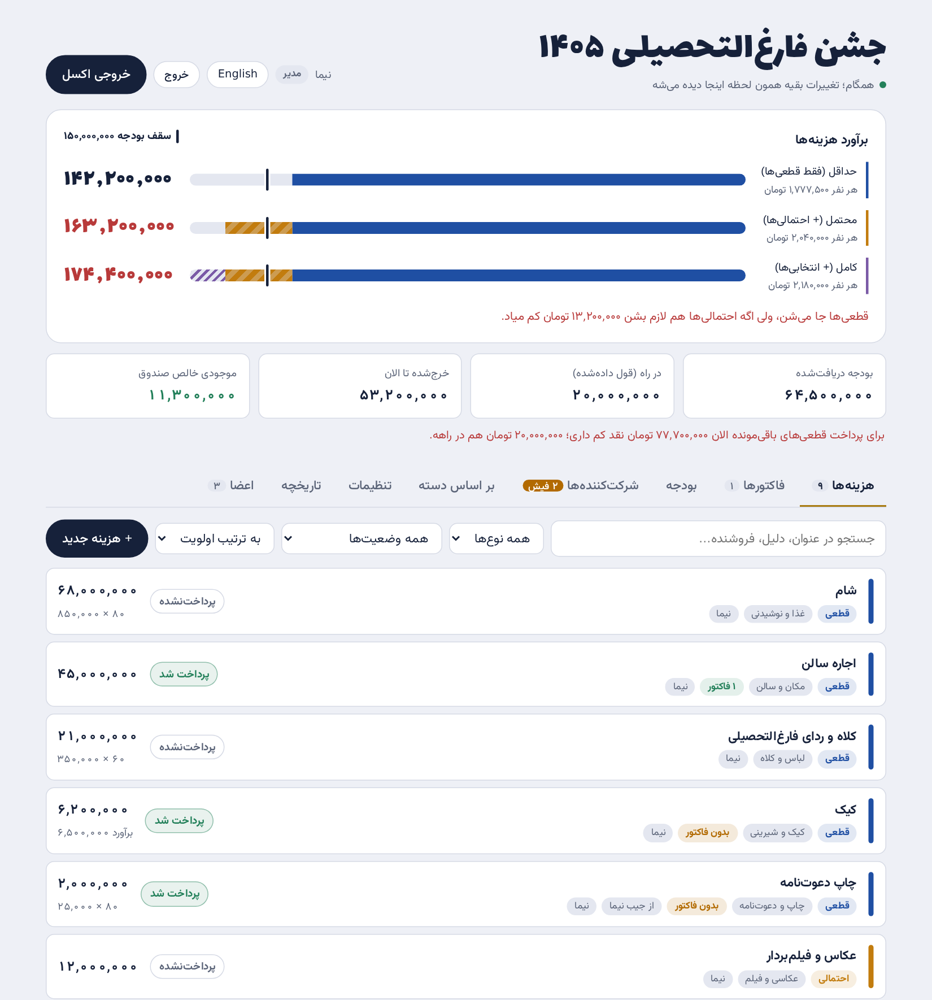

# حساب و کتاب جشن فارغ‌التحصیلی

سایتی ساده و رایگان برای مدیریت مالی یک جشن یا رویداد جمعی. تیم مالی هزینه‌ها، فاکتورها و بودجه را در آن ثبت می‌کند. شرکت‌کننده‌ها از داخل تلگرام وارد می‌شوند، سهم خود را می‌بینند و عکس فیش واریزی‌شان را می‌فرستند.



<sub>تصویر بالا با داده‌ی ساختگی تهیه شده است.</sub>

## امکانات

- **برآورد هزینه در برابر بودجه:** هر هزینه «قطعی»، «احتمالی» یا «انتخابی» است. صفحه‌ی اصلی سه برآورد (حداقل، محتمل، کامل) را کنار سقف بودجه و سهم هر نفر نشان می‌دهد.
- **صندوق:** بودجه‌ی دریافت‌شده، پول در راه، خرج‌شده و موجودی، و هشدار وقتی نقدینگی برای هزینه‌های قطعی باقی‌مانده کافی نیست.
- **فاکتورها:** عکس یا PDF فاکتور به هزینه‌ی مربوط وصل می‌شود. هزینه‌های پرداخت‌شده‌ی بدون فاکتور مشخص می‌شوند.
- **شرکت‌کننده‌ها و پرداخت سهم:**
  - لیست ثبت‌نام از فایل Excel یا CSV وارد می‌شود.
  - هر نفر با شماره‌ای که تلگرام تأیید می‌کند وارد صفحه‌ی پرداخت خودش می‌شود و عکس فیش را می‌فرستد.
  - تیم مالی فیش‌ها را تأیید یا رد می‌کند.
  - کسی که وارد سایت نمی‌شود، با یک لینک اختصاصی ربات مبلغ و شماره کارت را می‌بیند و عکس رسید را همان‌جا می‌فرستد.
- **شرکت‌کننده‌های جدید:** کسانی که بعد از قطعی شدن لیست فقط لوح، تندیس و/یا آلبوم عکس (Yearbook) می‌خواهند، جدا ثبت و حساب می‌شوند. پذیرایی‌شان جدا تصمیم گرفته می‌شود.
- **کد ورود رأی‌گیری:** هر شرکت‌کننده‌ی اصلی یک کد یکتا می‌گیرد که خودش در سایت و ربات می‌بیند. مدیرها هم کد هر نفر را می‌بینند تا به کسی که از ربات استفاده نمی‌کند بدهند.
- **نقش‌ها و تاریخچه:** هر کس فقط کارهایی را انجام می‌دهد که نقشش اجازه می‌دهد. هر تغییر با نام انجام‌دهنده و مقدار قبلی ثبت می‌شود.
- **ربات تلگرام (فقط مدیر):** متن پیام خوش‌آمد ربات از داخل سایت عوض می‌شود. از همان‌جا می‌شود برای همه‌ی کسانی که ربات را Start کرده‌اند پیام همگانی فرستاد.
- **پیام به گروه‌های شرکت‌کننده‌ها (فقط مدیر):** پیام شخصی‌شده به بدهکارها، پرداخت‌نکرده‌ها، تسویه‌شده‌ها و … . پیام از ربات می‌رود و به کسانی که ربات به آن‌ها نمی‌رسد، از حساب تلگرام شخصی مدیر (اختیاری) با شماره‌شان.
- **همگام‌سازی زنده و خروجی اکسل:** با زدن «خروجی اکسل» فهرستی می‌آید و فقط برگه‌هایی که تیک خورده‌اند در فایل می‌آیند: خلاصه، هزینه‌ها، فاکتورها، بودجه و سهم‌ها، شرکت‌کننده‌های اصلی، شرکت‌کننده‌های جدید، فیش‌ها و (فقط برای مدیر) کدهای رأی. انتخاب آخر در همان مرورگر یادش می‌ماند. فونت‌ها و کتابخانه‌ها همراه سایت هستند و سایت به CDN وابسته نیست.

## ساختار فایل‌ها

```
index.html                                  کل سایت (یک فایل)
config.js                                   آدرس Supabase، کلید عمومی و نام ربات تلگرام
schema.sql                                  ساختار دیتابیس، قوانین دسترسی، تاریخچه و فضای فایل‌ها
supabase/functions/telegram-auth/index.ts   تابع ورود با تلگرام و پاسخ‌گوی ربات (Edge Function)
vendor/ , fonts/                            کتابخانه‌ها و فونت‌ها (gramjs.js فقط وقتی بارگذاری می‌شود که مدیری حساب تلگرامش را وصل کند)
docs/                                       تصویر همین راهنما
```

## نقش‌ها

| نقش | دیدن و خروجی اکسل | افزودن و ویرایش | حذف | مدیریت اعضا |
|---|:-:|:-:|:-:|:-:|
| مدیر | ✓ | ✓ | ✓ | ✓ |
| ویرایشگر | ✓ | ✓ | ✗ | ✗ |
| بیننده | ✓ | ✗ | ✗ | ✗ |
| شرکت‌کننده | فقط صفحه‌ی پرداخت خودش | فقط فرستادن فیش | ✗ | ✗ |
| در انتظار تأیید | ✗ | ✗ | ✗ | ✗ |
| ردشده / مسدود | ✗ | ✗ | ✗ | ✗ |

- هر کسی که با تلگرام وارد شود، ابتدا «در انتظار تأیید» است.
- اگر شماره‌اش در لیست شرکت‌کننده‌ها باشد، با تأیید شماره در تلگرام خودکار شرکت‌کننده می‌شود.
- در غیر این صورت مدیر در تب **اعضا** نقشش را تعیین می‌کند، یا درخواستش را **رد** یا **مسدود** می‌کند.
- **ردشده:** پیام «درخواستت تأیید نشد» را می‌بیند و می‌تواند دوباره درخواست بدهد؛ درخواستش دوباره در پنل می‌آید.
- **مسدود:** دیگر نمی‌تواند درخواست بدهد و در پنل نمی‌آید، مگر مدیر رفع مسدودی کند.
- ردشده و مسدود فقط به پنل تیم مالی مربوط‌اند: اگر کسی شرکت‌کننده باشد، صفحه‌ی پرداختش مثل قبل کار می‌کند.
- این محدودیت‌ها در خود دیتابیس (Row Level Security) اعمال می‌شوند، نه فقط در ظاهر سایت.

## راه‌اندازی

همه‌ی مراحل روی پلن رایگان Supabase و GitHub Pages انجام می‌شود.

### ۱) دیتابیس Supabase

1. در [supabase.com](https://supabase.com) یک پروژه‌ی جدید بسازید.
2. محتوای `schema.sql` را کپی کنید و در بخش ۱ آن، `me@example.com` را به ایمیل مدیر تغییر دهید. این ایمیل فقط در دیتابیس ذخیره می‌شود و لازم نیست در مخزن تغییر کند.
3. در **SQL Editor** متن را بچسبانید و **Run** را بزنید.

### ۲) حساب مدیر

1. در **Authentication → Users → Add user → Create new user** یک کاربر بسازید:
   - ایمیل: همان ایمیل مرحله‌ی قبل
   - یک رمز عبور
   - گزینه‌ی **Auto Confirm User** روشن

   این کاربر خودکار مدیر می‌شود. ترتیب این مرحله و مرحله‌ی ۱ مهم نیست.
2. در **Authentication → Sign In / Providers** گزینه‌ی **Allow new users to sign up** را خاموش کنید. ورود با تلگرام همچنان کار می‌کند، چون کاربرهای تلگرامی را تابع ورود می‌سازد.

ورود با ایمیل روی صفحه‌ی اصلی پنهان است. مدیر برای ورود با ایمیل، آدرس سایت را با `?email` در انتها باز می‌کند؛ مثلاً `https://username.github.io/grad-finance-site/?email`.

### ۳) ربات تلگرام

در تلگرام به [@BotFather](https://t.me/BotFather) پیام دهید:

1. `/newbot` را بفرستید، سپس یک نام و یک نام کاربری (مثلاً `PartyFinanceBot`) انتخاب کنید. **توکن** ربات را محرمانه نگه دارید.
2. `/setdomain` را بفرستید و ربات را انتخاب کنید. سپس فقط دامنه‌ی سایت را بفرستید، بدون `https://` و بدون مسیر؛ مثلاً `username.github.io`.

### ۴) تابع ورود تلگرام (Edge Function)

**از داشبورد Supabase:**

1. **Edge Functions → Deploy a new function → Via Editor** را بزنید.
   - نام تابع دقیقاً `telegram-auth` باشد.
   - محتوای `supabase/functions/telegram-auth/index.ts` را جای کد پیش‌فرض بچسبانید و **Deploy** کنید.
2. در تنظیمات تابع، **Verify JWT** (یا Enforce JWT verification) را خاموش کنید. کاربر هنگام ورود هنوز نشستی ندارد؛ امنیت ورود با بررسی امضای تلگرام داخل تابع تأمین می‌شود.
3. در **Edge Functions → Secrets** یک secret با نام `TELEGRAM_BOT_TOKEN` و مقدار توکن ربات اضافه کنید.

**یا با Supabase CLI:**

```bash
supabase functions deploy telegram-auth --no-verify-jwt
supabase secrets set TELEGRAM_BOT_TOKEN=123456:ABC...
```

هر بار که فایل تابع در مخزن تغییر می‌کند، باید دوباره Deploy شود.

### ۵) تنظیم `config.js`

مقدارها را از **Project Settings → API** بردارید:

| کلید | مقدار |
|---|---|
| `supabaseUrl` | آدرس پروژه، مثل `https://abcd1234.supabase.co` |
| `supabaseAnonKey` | کلید **anon** یا **publishable**. این کلید عمومی است. کلید `service_role` یا `secret` هرگز نباید این‌جا قرار بگیرد. |
| `telegramBot` | نام کاربری ربات، بدون `@` |
| `supportIds` | اختیاری: آیدی تلگرام مسئول‌های مالی، بدون `@`؛ مثلاً `['ali_finance']`. به کسی که شماره‌اش در لیست نیست، این آیدی‌ها برای پیگیری نشان داده می‌شوند. |

### ۶) انتشار روی GitHub Pages

1. مخزن را Fork کنید (یا فایل‌ها را در یک مخزن عمومی بگذارید).
2. در **Settings → Pages** گزینه‌ی **Deploy from a branch** را با شاخه‌ی `main` و پوشه‌ی root انتخاب کنید.

هیچ فایلی در مخزن اطلاعات محرمانه ندارد. کلید `config.js` عمومی است و ایمیل مدیر فقط در دیتابیس ذخیره می‌شود.

### ۷) فعال کردن دکمه‌ی ربات

بعد از بالا آمدن سایت، مدیر در تب **تنظیمات** دکمه‌ی **راه‌اندازی دکمه‌ی ربات** را می‌زند. از آن به بعد:

- هر کس ربات را Start کند، پیام خوش‌آمد با دکمه‌ی «ورود به سایت» می‌گیرد.
- دکمه‌ی منوی ربات سایت را داخل خود تلگرام (Mini App) باز می‌کند و کاربر بدون هیچ کلیکی وارد می‌شود.

متن پیام خوش‌آمد در همان تب، در بخش **پیام خوش‌آمد ربات**، قابل تغییر است. `{name}` در متن جای اسم کوچک هر شخص قرار می‌گیرد.

## استفاده

### تیم مالی

- اعضای تیم با تلگرام وارد می‌شوند. مدیر در تب **اعضا** نقش هر نفر (بیننده، ویرایشگر یا مدیر) را تعیین می‌کند و همان لحظه صفحه‌ی آن فرد باز می‌شود.
- نام نمایشی هر عضو در همان تب قابل تغییر است. همین نام در تاریخچه و برچسب‌های «ثبت‌کننده» دیده می‌شود.
- اعضا در تب **اعضا** در این گروه‌ها دیده می‌شوند: درخواست‌های جدید، تیم مالی، شرکت‌کننده‌ها، ردشده‌ها و مسدودشده‌ها. سه گروه آخر بسته هستند و با یک کلیک باز می‌شوند.
- نقش هر عضو تیم مالی را می‌شود به «شرکت‌کننده» تغییر داد و برعکس، از همان فهرست نقش‌ها.
- «برداشتن دسترسی» عضو تیم را به «ردشده» می‌برد. اگر بخواهد، می‌تواند دوباره درخواست بدهد.

### شرکت‌کننده‌ها و پرداخت سهم

1. **وارد کردن لیست:** در تب **شرکت‌کننده‌ها**، با **ورود از شیت** فایل ثبت‌نام (Excel یا CSV) وارد می‌شود.
   - ستون «شماره تماس» لازم است. «نام»، «گرایش» و «تعداد مهمان» هم خوانده می‌شوند.
   - عنوان ستون‌ها لازم نیست دقیق باشد؛ مثلاً «شماره تماس (ترجیحاً موبایل)» هم شناخته می‌شود.
   - تعداد مهمان می‌تواند «۲»، «۲ نفر»، «دو نفر» یا «ندارم» باشد. موارد مبهم قبل از وارد شدن برای بررسی نشان داده می‌شوند.
   - اگر در خانه‌ی شماره چیز دیگری هم نوشته شده باشد (آیدی تلگرام، یا دو شماره که کنار یکی «تلگرام» آمده)، شماره‌ی موبایل برداشته می‌شود و متن کامل در یادداشت آن نفر می‌ماند.
   - کسی که شماره‌ی معتبر ندارد با برچسب «بدون شماره» ثبت می‌شود. تا شماره‌اش اضافه نشود خودش نمی‌تواند وارد شود، ولی تیم مالی می‌تواند پرداختش را دستی ثبت کند.
   - وارد کردن دوباره‌ی همان فایل آدم تکراری نمی‌سازد.
2. **مبلغ سهم:** در **ویرایش اطلاعات پرداخت** شماره کارت، مبلغ پیش‌فرض سهم و مبلغ هر مهمان تعیین می‌شود. سهم هر نفر خودکار «سهم پیش‌فرض + تعداد مهمان × مبلغ هر مهمان» است. برای مبلغ متفاوت، «مبلغ کل» در پنجره‌ی همان نفر دستی نوشته می‌شود.
3. **ورود شرکت‌کننده:** هر نفر سایت را از ربات باز می‌کند و **📱 تأیید شماره با تلگرام** را می‌زند.
   - شماره از خود تلگرام گرفته و با لیست مقایسه می‌شود. شماره در هیچ‌جای سایت تایپ نمی‌شود.
   - کسی که سایت را در مرورگر باز کند، فقط دکمه‌ی باز کردن ربات را می‌بیند.
   - اگر شماره در لیست نباشد، به پیام دادن به مسئول‌های مالی راهنمایی می‌شود.
   - پس از تأیید، مبلغ سهم (با جزئیات مهمان‌ها) و اطلاعات کارت را می‌بیند و عکس فیش را می‌فرستد. عکس روی گوشی خودش فشرده می‌شود.
   - **اضافه کردن مهمان:** خودش می‌تواند به تعداد مهمان‌هایش اضافه کند. قبل از ثبت، سهم جدید را می‌بیند و تأیید می‌دهد. کم کردن مهمان فقط از طریق تیم مالی است. اگر برای او «مبلغ کل» دستی تعیین شده باشد، هزینه‌ی مهمان‌های جدید به همان اضافه می‌شود. هر تغییر در **تاریخچه** ثبت می‌شود.
   - **چیزهایی که دریافت خواهید کرد:** در صفحه‌ی هر نفر کارتی هست که نشان می‌دهد چه چیزهایی به او می‌رسد: برای شرکت‌کننده‌های اصلی آلبوم عکس (Yearbook)، تندیس و پذیرایی برای خودش و مهمان‌هایش؛ برای شرکت‌کننده‌های جدید فقط همان‌هایی که خواسته (و پذیرایی، وقتی تصمیمش گرفته شد).
   - **پرداخت اضافه:** بعد از تسویه هم می‌تواند «فیش پرداخت اضافه» بفرستد. این فیش مثل بقیه بررسی می‌شود. مبلغ بیشتر از سهم، هم برای خودش و هم در فهرست شرکت‌کننده‌ها («+X اضافه») دیده می‌شود.
4. **بررسی فیش:** فیش‌ها در تب **شرکت‌کننده‌ها**، زیر «فیش‌های در انتظار بررسی» می‌آیند.
   - با **تأیید**، مبلغ به «سهم نفرات» در بودجه اضافه می‌شود.
   - با **رد**، دلیل رد به خود فرد نشان داده می‌شود.
   - برگرداندن فیش تأییدشده فقط کار مدیر است.
   - مدیر می‌تواند فیش (مثلاً فیش تکراری یا آزمایشی) را با **حذف فیش** کامل پاک کند. اگر فیش تأیید شده باشد، مبلغش هم از «سهم نفرات» کم می‌شود.
5. **پرداخت نقدی یا مستقیم:** برای پرداختی که مستقیم به تیم مالی رسیده، روی نام فرد بزنید و **+ ثبت پرداخت این نفر** را انتخاب کنید (عکس فیش اختیاری است). پرداخت همان لحظه تأیید می‌شود و وضعیت فرد هم درست می‌شود.
6. **چند نفر با یک شماره:** اگر چند نفر با یک شماره ثبت‌نام کرده باشند، هر کدام جدا ثبت می‌شوند و برچسب «شماره‌ی مشترک» می‌گیرند. صاحب شماره پس از ورود بین آن‌ها جابه‌جا می‌شود و برای هر کدام جدا فیش می‌فرستد.
7. **لینک پرداخت در ربات:** برای کسی که خودش وارد سایت نمی‌شود (مثلاً دستی اضافه شده)، در پنجره‌ی همان نفر **کپی لینک** را بزنید و لینک را برایش بفرستید. در پیام گروهی هم `{link}` جای لینک هر نفر می‌نشیند.
   - با باز کردن لینک، ربات مبلغ سهم، باقی‌مانده و شماره کارت را با دو دکمه‌ی **کپی مبلغ (ریال)** و **کپی شماره کارت** نشان می‌دهد.
   - بعد از واریز، دکمه‌ی **🧾 ثبت پرداخت** را می‌زند و عکس رسید (یا اسکرین‌شات) را می‌فرستد. اگر مبلغ واریزی با باقی‌مانده فرق دارد، عددش را زیر عکس (کپشن) می‌نویسد. رسید با برچسب «از ربات تلگرام» در صف بررسی می‌آید.
   - اگر بعد از زدن دکمه به‌جای عکس پیام دیگری بفرستد (یا ۳۰ دقیقه بگذرد)، ثبت رسید لغو می‌شود و باید دوباره دکمه را بزند. عکسی که بدون زدن دکمه فرستاده شود ثبت نمی‌شود.
   - باز کردن دوباره‌ی لینک، جزئیات پرداخت را دوباره نشان می‌دهد. پیام‌های دیگر (حتی `/start`) همان جواب همیشگی ربات را می‌گیرند.
   - برای فعال شدن دکمه‌ی **ثبت پرداخت** در رباتی که قبلاً راه‌اندازی شده، یک بار دیگر **راه‌اندازی دکمه‌ی ربات** را در تب **تنظیمات** بزنید.
   - هر کس لینک را داشته باشد می‌تواند برای آن نفر رسید بفرستد (رسیدها به‌هرحال بررسی می‌شوند). **لینک جدید** لینک قبلی را باطل می‌کند.

### شرکت‌کننده‌های جدید (لوح، تندیس و آلبوم عکس)

کسانی که بعد از قطعی شدن لیست اصلی اضافه می‌شوند و فقط لوح، تندیس، آلبوم عکس (Yearbook) یا چندتایشان را می‌خواهند:

- **ثبت:** در تب **شرکت‌کننده‌ها**، **جدید (لوح و تندیس)** را بزنید و **+ شرکت‌کننده** را انتخاب کنید (یا در پنجره‌ی هر نفر نوع را «جدید» کنید). لوح، تندیس، آلبوم عکس و وضعیت پذیرایی همان‌جا تعیین می‌شود.
- **مبلغ:** در **ویرایش اطلاعات پرداخت** مبلغ لوح، تندیس، آلبوم عکس و پذیرایی هر نفر تعیین می‌شود. مبلغ هر نفر جمع چیزهایی است که خواسته، به‌اضافه‌ی پذیرایی اگر «بله» باشد. مهمان ندارند و خودکار کد رأی نمی‌گیرند (مدیر می‌تواند به هر کدام که بخواهد دستی کد بدهد).
- **تصمیم پذیرایی:** کنار هر نفر سه دکمه‌ی **بله / نه / ؟** هست. بالای فهرست هم می‌شود همه‌ی تصمیم‌نشده‌ها را یک‌جا «با پذیرایی» یا «بدون پذیرایی» کرد. خلاصه‌ی بالای فهرست تعداد لوح، تندیس، آلبوم عکس، پذیرایی و «کل پذیرایی» (اصلی‌ها و مهمان‌هایشان، به‌اضافه‌ی جدیدهای با پذیرایی) را نشان می‌دهد.
- **جدا از لیست اصلی:** در خلاصه‌ها، پیام گروهی (گروه «شرکت‌کننده‌های جدید») و خروجی اکسل (برگه‌ی جدای «شرکت‌کننده‌های جدید») جدا حساب می‌شوند.

### کدهای ورود رأی‌گیری

هر شرکت‌کننده‌ی اصلی یک کد یکتا برای ورود به رأی‌گیری دارد. هر نفر کد خودش (و کسانی که با همان شماره ثبت‌نام کرده‌اند) را در صفحه‌ی پرداخت سایت و هر بار که ربات را باز می‌کند می‌بیند. مدیرها کد هر نفر را در فهرست شرکت‌کننده‌ها، پنجره‌ی همان نفر و خروجی اکسل می‌بینند تا به کسی که از ربات و سایت استفاده نمی‌کند بدهند. بیننده‌ها و ویرایشگرها کدها را نمی‌بینند.

در تب **شرکت‌کننده‌ها**، دکمه‌ی **کد رأی** بالای فهرست (فقط مدیر):

1. **اضافه کردن کدها:** فایل CSV یا اکسل کدها را انتخاب کنید (هر کد در یک خانه، حرف بزرگ انگلیسی و رقم). کدهای تکراری نادیده گرفته می‌شوند.
2. **تخصیص به همه‌ی بدون‌کدها:** به هر شرکت‌کننده‌ی اصلی بدون کد، یک کد آزاد تصادفی داده می‌شود. کسی که بعداً به لیست اصلی اضافه شود خودکار کد می‌گیرد.
3. **ارسال کد هر نفر از ربات (اختیاری):** ربات کد هر نفر را برای خودش می‌فرستد؛ برای کسانی که با تلگرام وارد سایت شده‌اند. زیر این پیام دکمه‌ی ورود به سایت نیست.

- **دکمه‌ی ورود به رأی‌گیری:** کنار کد هر نفر (در سایت و پیام‌های ربات) دکمه‌ی **🗳 ورود به رأی‌گیری** می‌آید که سایت رأی‌گیری را در مرورگر باز می‌کند. آدرسش در `config.js` (`voteUrl`) و برای ربات در secret اختیاری `VOTE_URL` تابع است (پیش‌فرض `https://armo.fun/`).
- **دیدن و کپی کد:** کد هر نفر کنار نامش در فهرست، و با دکمه‌ی کپی در پنجره‌ی همان نفر دیده می‌شود. جستجو با کد هم کار می‌کند.
- **کد برای شرکت‌کننده‌های جدید:** خودکار کد نمی‌گیرند. در پنجره‌ی هر کدام که بخواهید، **یه کد بهش بده** را بزنید؛ کد از کدهای آزاد داده می‌شود و مثل بقیه در سایت، ربات و اکسل دیده می‌شود.
- **پس گرفتن کد:** در پنجره‌ی هر نفر، **پس گرفتن کد** کدش را باطل می‌کند (به کس دیگری داده نمی‌شود).
- **کد جدید:** در پنجره‌ی هر نفر، **کد جدید بده** کد فعلی را باطل می‌کند و یک کد آزاد دیگر به او می‌دهد.
- **حذف یا انتقال:** کد کسی که حذف می‌شود یا به «شرکت‌کننده‌های جدید» منتقل می‌شود باطل می‌شود و به کس دیگری داده نمی‌شود.
- **محدودیت:** کسی که به داشبورد Supabase دسترسی دارد (صاحب پروژه) کدها را در جدول `voting_codes` می‌بیند. لینک پرداخت ربات کد را نشان نمی‌دهد، چون هر کس لینک را داشته باشد آن را می‌بیند.

### پیام همگانی از طرف ربات

در تب **تنظیمات**، بخش **پیام همگانی از طرف ربات** (فقط مدیر):

1. متن پیام را بنویسید. می‌توانید دکمه‌ی «ورود به سایت» را زیر پیام بگذارید.
2. **ارسال آزمایشی برای خودم** را بزنید تا پیام فقط برای خودتان برود و ببینید چطور دیده می‌شود. برای این کار باید خودتان ربات را Start کرده باشید.
3. **ارسال برای همه** را بزنید. سایت تعداد گیرنده‌ها را می‌گوید و تأیید می‌گیرد.

- **گیرنده‌ها:** همه‌ی کسانی که ربات را Start کرده‌اند یا با تلگرام وارد سایت شده‌اند.
- **بدون پیام:** کسی که ربات را بلاک کرده یا هیچ‌وقت Start نکرده، پیامی نمی‌گیرد و در نتیجه‌ی ارسال جدا شمرده می‌شود.
- **سابقه:** هر پیام همگانی با نام فرستنده و تعداد گیرنده‌ها در تب **تاریخچه** ثبت می‌شود.

### پیام به گروه‌های شرکت‌کننده‌ها

در تب **شرکت‌کننده‌ها**، دکمه‌ی **پیام به شرکت‌کننده‌ها** (فقط مدیر):

1. **گروه را انتخاب کنید:** همه‌ی بدهکارها، پرداخت نکرده، بخشی پرداخت کرده، فیش در انتظار بررسی، تسویه، هنوز وارد سایت نشده، شرکت‌کننده‌های جدید، یا همه. کنار هر گروه تعدادش می‌آید.
2. **متن را بنویسید یا یکی از متن‌های آماده را بزنید:** یادآوری پرداخت، تشکر، دعوت به ورود، لینک پرداخت. جای `{name}`، `{amount}`، `{paid}`، `{remaining}` و `{link}` اسم، سهم، پرداخت‌شده، باقی‌مانده و لینک پرداخت ربات هر نفر می‌نشیند. پیش‌نمایش پیام اولین نفر نشان داده می‌شود.
3. **گیرنده‌ها را ببینید:** در فهرست گیرنده‌ها کنار هر نفر می‌آید که پیامش از کدام راه می‌رود، و می‌شود تیک هر کسی را برداشت.
4. **ارسال آزمایشی برای خودم** را بزنید تا پیام از ربات برای خودتان بیاید، بعد **ارسال**.

پیام هر نفر از یکی از این راه‌ها می‌رود:

- **ربات:** برای کسی که با تلگرام وارد سایت شده (یا صاحب شماره‌ی مشترکش وارد شده). دکمه‌ی «ورود به سایت» زیر پیام می‌آید.
- **حساب تلگرام شخصی مدیر:** برای بقیه، و کسانی که ربات را بلاک کرده‌اند، با شماره‌شان. پیام‌ها یکی‌یکی و با چند ثانیه فاصله می‌روند تا حساب محدود نشود، و به‌جای دکمه، لینک ربات زیر پیام می‌آید. می‌شود وسط کار **توقف** را زد. اگر تلگرام حساب را محدود کند، ارسال خودش می‌ایستد.

در آخر فهرست کسانی که پیام به آن‌ها نرسید، با دلیلش، نشان داده می‌شود. هر ارسال با نام مدیر در **تاریخچه** ثبت می‌شود.

### حساب تلگرام شخصی مدیر (اختیاری)

ربات فقط به کسانی پیام می‌دهد که با تلگرام وارد سایت شده‌اند. برای رسیدن پیام به بقیه، مدیر حساب تلگرام خودش را وصل می‌کند (تب **تنظیمات** ← **حساب تلگرام شخصی من**):

1. در [my.telegram.org](https://my.telegram.org/apps) وارد شوید و از **API development tools** مقدارهای `api_id` و `api_hash` را بردارید. این‌ها همان مقدارهایی هستند که کتابخانه‌هایی مثل Telethon هم استفاده می‌کنند.
2. این دو مقدار و شماره‌ی حساب تلگرام‌تان را وارد کنید و **ارسال کد ورود** را بزنید.
3. کدی را که تلگرام فرستاده وارد کنید. اگر رمز دو مرحله‌ای دارید، آن را هم وارد کنید.

نکته‌های امنیتی و فنی:

- **ذخیره‌ی نشست:** فقط در همان مرورگر ذخیره می‌شود، نه در دیتابیس. هر کس آن را داشته باشد به کل حساب دسترسی دارد. روی دستگاه مشترک از آن استفاده نکنید و بعد از کار **قطع اتصال** را بزنید. نشست در تلگرام ← تنظیمات ← دستگاه‌ها هم با نام «Party finance panel (web)» دیده و بسته می‌شود.
- **VPN:** حساب فقط موقع ارسال پیام (یا با **بررسی اتصال**) به تلگرام وصل می‌شود، مستقیم از مرورگر. تلگرام در ایران فیلتر است، پس این کار VPN لازم دارد. بقیه‌ی سایت VPN لازم ندارد.
- **پیدا شدن با شماره:** شخص فقط وقتی پیدا می‌شود که تنظیمات حریم خصوصی‌اش اجازه‌ی پیدا شدن با شماره را بدهد.
- **محدود شدن حساب:** پیام زیاد به کسانی که مخاطب شما نیستند ممکن است حساب را موقتاً محدود کند.
- **کتابخانه:** `vendor/gramjs.js` نسخه‌ی مرورگری کتابخانه‌ی [GramJS](https://github.com/gram-js/gramjs) (۲.۲۶.۲۲، مجوز MIT) است.

## نکته‌ها

- **کاربرهای تلگرامی:** در Supabase با ایمیل ساختگی مثل `tg123456@telegram.local` ذخیره می‌شوند. این ایمیل واقعی نیست و چیزی به آن ارسال نمی‌شود.
- **دکمه‌ی ورود تلگرام در مرورگر:** فقط روی دامنه‌ای کار می‌کند که با `/setdomain` ثبت شده است (روی `localhost` یا با باز کردن مستقیم فایل کار نمی‌کند).
- **اسکریپت تلگرام:** اسکریپت Mini App تلگرام در `vendor/telegram-web-app.js` همراه سایت است. دلیلش این است که telegram.org در برخی شبکه‌ها در دسترس نیست و صفحه‌ی داخل تلگرام فایل‌ها را با اینترنت معمولی دستگاه بارگذاری می‌کند، نه از مسیر اتصال خود تلگرام.
- **خروجی اکسل:** برخی نسخه‌های تلگرام دانلود فایل را پشتیبانی نمی‌کنند؛ برای خروجی اکسل سایت را در مرورگر باز کنید.
- **توقف پروژه‌ی رایگان:** پروژه‌ی رایگان Supabase پس از حدود یک هفته بی‌استفاده ماندن متوقف می‌شود. داده‌ها حفظ می‌شوند و با **Restore** برمی‌گردند.
- **اجرای دوباره‌ی `schema.sql`:** روی پروژه‌ای که با همین فایل ساخته شده بی‌خطر است. داده‌ها پاک نمی‌شوند و فقط تابع‌ها و قوانین دسترسی دوباره ساخته می‌شوند.

## مجوز

[MIT](LICENSE)
